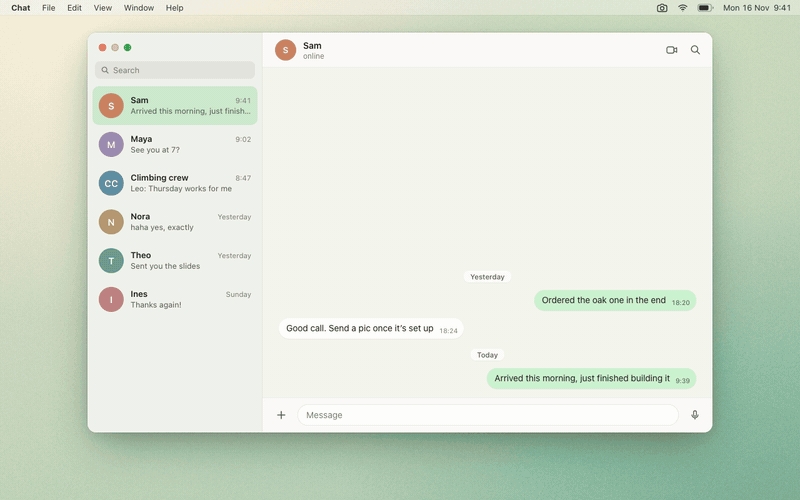

<h1 align="center">SnapSend</h1>

<p align="center">
  Take a photo with your Mac's camera and drop it straight into a WhatsApp chat.
</p>

<p align="center">
  
</p>

<p align="center">
  <a href="docs/demo.mp4">Watch in full quality</a>
</p>

WhatsApp for Mac sends photos from your files, but it has no button to take one with the webcam. SnapSend is a small menu bar app that adds that step, and it works entirely from the keyboard.

## How it works

1. Open a chat in WhatsApp.
2. Press **⌃⌥⌘C**. A camera window appears.
3. Press **Space** to take the photo. **Delete** retakes, **Esc** closes.
4. Press **Return**. SnapSend pastes the photo into the open chat, where WhatsApp shows its usual preview and caption field. Press Return again to send.

You can also drag the photo out of the window into any app or folder.

## Features

- Works with the built-in camera, external webcams, and an iPhone through Continuity Camera.
- Lives in the menu bar, with no Dock icon.
- Selfies come out mirrored, matching the preview. Turn off **Mirror Selfies** in the menu to keep text readable.
- The camera turns off as soon as the window closes or you click somewhere else.
- **Open at Login** is in the menu bar icon's menu.

## Install

You need macOS 14 Sonoma or later and Xcode or the Xcode Command Line Tools (`xcode-select --install`).

```sh
git clone https://github.com/Davidtzuke/snapsend.git
cd snapsend
make install
```

`make install` builds a universal app (Apple silicon and Intel), copies it to `~/Applications` and launches it. `make` alone builds into `build/`.

If you have an Apple Development certificate, the build script signs with it, so macOS remembers SnapSend's permissions between builds. Without one, the app is signed ad hoc and macOS asks again after every rebuild.

## Permissions

macOS asks for two permissions the first time you need them:

| Permission | When | Why |
| --- | --- | --- |
| Camera | The camera window opens | To take the photo |
| Accessibility | You first press Return to send | To press ⌘V in WhatsApp for you |

Without Accessibility access, SnapSend still copies the photo, and the window tells you to click the chat and press ⌘V. Turn it on in **System Settings → Privacy & Security → Accessibility**.

## Privacy

SnapSend has no network code and collects nothing. The camera runs only while its window is open. Photos stay on your Mac: on the clipboard, plus a temporary JPEG for drag and drop that SnapSend deletes the next time you open the camera or quit.

## How it's built

About 900 lines of Swift with AppKit and SwiftUI, and no dependencies.

- **Hotkey:** Carbon's `RegisterEventHotKey`, which needs no permission.
- **Camera:** an AVFoundation video output. The photo is the last frame the preview showed, so you get what you saw.
- **Window:** a non-activating panel. WhatsApp stays the active app while the camera is open, so the synthetic ⌘V lands in the chat you were looking at.

```
App/        Info.plist and entitlements
Sources/    The Swift code
scripts/    build.sh, used by the Makefile
docs/       Demo video and screenshot
```

## Limitations

- SnapSend pastes into whichever chat is open. If WhatsApp isn't running, SnapSend opens it, but you may need to pick the chat and press ⌘V yourself.
- The shortcut is fixed at ⌃⌥⌘C. To change it, edit `applicationDidFinishLaunching` in `Sources/App.swift`.

## Credits

The desk photo in the demo is by [Aleksi Tappura](https://unsplash.com/photos/mCg0ZgD7BgU) on Unsplash. The chat window in the demo is a mockup.

SnapSend is an independent project and is not affiliated with WhatsApp or Meta.

## License

[MIT](LICENSE)
